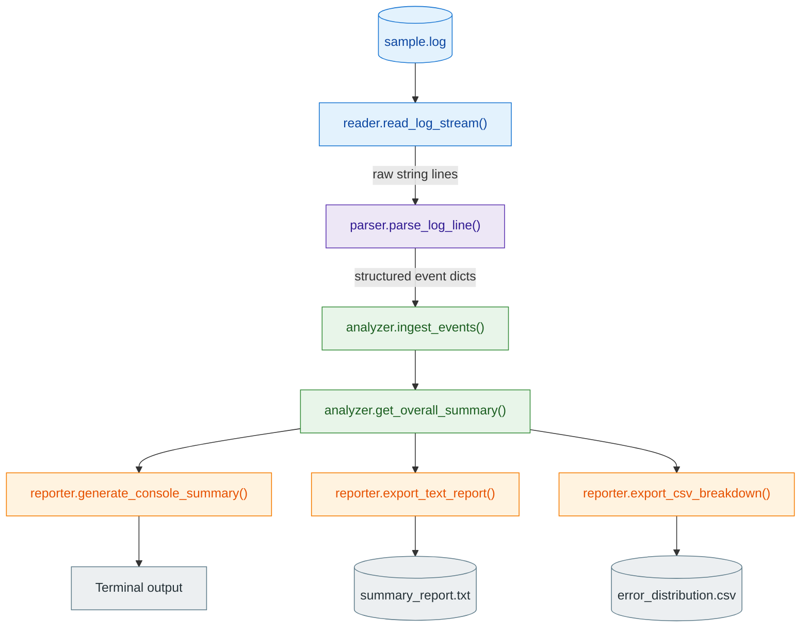

# Log File Analyzer & Error Monitoring Tool

A command-line utility that reads application log files, extracts timestamped
`INFO` / `WARNING` / `ERROR` events, classifies them, counts recurring issues,
and produces an operational summary plus exportable text/CSV reports.

---

## 1. Introduction — What & Why

Modern applications emit huge volumes of log output. Reading those logs by hand to
find out *what is failing*, *how often*, and *where* is slow and error-prone. This
tool automates that triage:

- **Reads** a log file line by line in a memory-safe (streaming) way, so it scales
  to very large files without loading everything into RAM.
- **Parses** each line with a regular expression to extract structured fields
  (`timestamp`, `level`, `module`, `message`).
- **Analyzes** the parsed events with `collections.Counter` to compute level
  distribution, parse-success rate, and the top recurring warnings and errors.
- **Reports** a human-readable console summary and exports a text report and a CSV
  breakdown for dashboards or spreadsheets.

**Why it's helpful:** it turns raw, unstructured logs into an at-a-glance health
report — surfacing the most frequent errors first so engineers can prioritize the
issues that matter most.

---

## 2. Project Structure

```
Capstone project/
├── main.py                 # CLI entry point — wires all stages together
├── generate_log.py         # Utility: generate a large sample log for testing
├── application.log         # Runtime log produced by the tool itself
├── data/
│   ├── sample.log          # Small example input log
│   └── large_sample.log    # 100,000-line generated log (via generate_log.py)
├── reports/
│   ├── summary_report.txt  # Generated text report
│   └── error_distribution.csv  # Generated CSV breakdown
├── src/
│   ├── __init__.py         # Package marker + public API re-exports
│   ├── reader.py           # Stage 1: memory-safe file streaming
│   ├── parser.py           # Stage 2: regex parsing & field extraction
│   ├── analyzer.py         # Stage 3: Counter-based statistics
│   └── reporter.py         # Stage 4: console/text/CSV reporting
└── test/
    ├── __init__.py         # Package marker
    └── test_cases.py       # Unit tests
```

> The package exposes a clean public API via `src/__init__.py`, so callers can
> `from src import LogAnalyzer, read_log_stream, parse_log_line` directly.

### How the stages fit together (data flow)



| Stage | Owner | Function | Responsibility |
|-------|-------|----------|----------------|
| 1. Ingestion |  Pratik | `read_log_stream()` | Stream the log file line by line |
| 2. Transformation | Tejas | `parse_log_line()` | Turn raw lines into structured event dicts |
| 3. Aggregation | Vaishnavi | `ingest_events()` / `get_overall_summary()` | Tally counts and compute metrics |
| 4. Presentation | Arpit | `generate_console_summary()` / `export_*()` | Render console, text, and CSV reports |

---

## 3. How Each Module Works

### `src/reader.py` — Ingestion & memory-safe streaming
- Validates the path (non-empty string, file exists, is a real file).
- Opens the file and **`yield`s one line at a time** (a generator), so memory use
  stays constant regardless of file size.
- Raises clear, specific exceptions (`ValueError`, `FileNotFoundError`,
  `PermissionError`) and logs every failure.

### `src/parser.py` — Regex processing & classification
- Compiles a single `LOG_PATTERN` regex with named groups:
  `timestamp`, `level`, `module`, `message`.
- `parse_log_line()` returns a structured `dict` on a match, or `None` for
  malformed lines (which are then counted as "skipped").

### `src/analyzer.py` — Counter-based statistics
- `LogAnalyzer` keeps several `Counter`s: `level_counts`, `module_counts`,
  `error_messages`, `warning_messages`.
- `ingest_events()` consumes the line stream, parses each line, and updates counts.
- Helper methods expose the results: `get_top_errors()`, `get_top_warnings()`,
  and `get_overall_summary()` (totals, skipped lines, error/warning rates,
  parse-success rate).

### `src/reporter.py` — Reporting engine
- `generate_console_summary(analyzer, top_n)` builds and **returns** the formatted
  report string (printing is handled by `main.py`, keeping it reusable/testable).
- `export_text_report()` writes that string to `reports/summary_report.txt`.
- `export_csv_breakdown(analyzer, path, top_n)` writes level counts, top warnings,
  and top errors to `reports/error_distribution.csv`.
- Both exporters **auto-create the output directory** if it does not exist.

### `main.py` — Orchestration
- Parses CLI arguments, configures logging, then runs the
  read → analyze → report pipeline inside a `try/except` block that maps failures
  to clear log messages and a non-zero exit code.

---

## 4. Steps to Execute the Program

**Prerequisites:** Python 3.8+ (uses only the standard library — no `pip install`
needed).

Run from the project root (`Capstone project/`):

```bash
# Default run — uses data/sample.log and writes into reports/
python3 main.py --input data/sample.log
```

```bash
# This run — uses data/large_sample.log and writes into reports/ (100000 records)
python3 main.py --input data/large_sample.log
```


### Command-line options

| Flag | Alias | Default | Description |
|------|-------|---------|-------------|
| `--input` | `-i` | `data/sample.log` | Path to the log file to analyze |
| `--output-text` | | `reports/summary_report.txt` | Text report output path |
| `--output-csv` | | `reports/error_distribution.csv` | CSV breakdown output path |
| `--top` | | `5` | Number of top recurring errors/warnings to report |

Example with custom paths and top count:

```bash
python3 main.py -i data/sample.log --top 3 \
  --output-text reports/my_summary.txt \
  --output-csv reports/my_breakdown.csv
```

### Generating a large sample log (optional)

To test the tool at scale, generate a 100,000-line log with a controlled error
distribution:

```bash
python3 generate_log.py
python3 main.py --input data/large_sample.log --top 5
```

This writes `data/large_sample.log` (99,820 valid lines + 180 malformed) and
produces reproducible metrics. Edit the `ERROR_SIGNATURES` / `WARNING_SIGNATURES`
constants at the top of `generate_log.py` to change the distribution.

### Expected output
- A formatted summary printed to the console.
- `reports/summary_report.txt` and `reports/error_distribution.csv` written to disk.
- Runtime events appended to `application.log`.

> The output folder is **created automatically** if it does not exist, so runs
> never fail just because `reports/` is missing.

---

## 5. Logging

- Configured centrally in `main.py` via `configure_app_logging()`.
- Writes to **both** `application.log` (file) and the console (stdout).
- Every module uses a named logger (`LogAnalyzer.Reader`, `LogAnalyzer.Parser`,
  `LogAnalyzer.Analyzer`, `LogAnalyzer.Reporter`, `LogAnalyzer.Main`) so log lines
  are traceable to their source stage.

## 6. Error Handling

- **Reader** validates input and raises specific exceptions for missing files,
  invalid paths, and permission problems.
- **Parser** safely returns `None` for malformed lines instead of crashing.
- **Reporter** wraps file writes in `try/except` and re-raises after logging.
- **main** catches `FileNotFoundError` / `PermissionError` / `IOError` separately
  from unexpected errors and exits with status `1` on failure.

## 7. Data Handling

- Streaming generator keeps memory usage flat for large files.
- Malformed lines are counted (not discarded silently), feeding the
  "parse success rate" metric.
- Output is written in both human-readable (`.txt`) and machine-readable (`.csv`)
  formats.

---

## 8. Running the Tests

```bash
python3 -m unittest test/test_cases.py -v
```

The suite in `test/test_cases.py` covers:

| Test class | What it checks |
|------------|----------------|
| `TestReader` | Missing-file error, correct line streaming |
| `TestParser` | Valid line parsing, malformed/empty lines return `None` |
| `TestAnalyzer` | Line/parse counts, level counts, top errors |
| `TestReporter` | Report string generation and CSV export |

All tests pass against the current module interfaces.

---

## 9. Prompts Used (AI-Assisted Development)

The few prompts that mattered most for keeping the code scalable and readable:

**Modular architecture**
> "Design a modular Python log-analysis CLI split into four single-responsibility
> stages — reader, parser, analyzer, reporter — each with its own named logger."

**Memory-safe scalability**
> "Make the reader a generator that yields one line at a time so it handles very
> large log files without loading them into memory."

**Readability & type safety**
> "Follow PEP 8 (snake_case), add type hints and type aliases, and expose a clean
> public API through the package __init__."

**Robustness**
> "Add centralized file+console logging, specific exceptions, and auto-create the
> output directory so report generation never fails on a missing folder."

---

## 10. Team Members' Contributions

| Member | Module | Responsibility |
|--------|--------|----------------|
| **Pratik** | `src/reader.py` | File ingestion & memory-safe line streaming; path validation and file-access error handling |
| **Tejas** | `src/parser.py` | Regex processing, field extraction, event classification, and structured data output |
| **Vaishnavi** | `src/analyzer.py` | Counter-based statistical analysis, top-error/warning correlation, and summary metrics |
| **Arpit** | `src/reporter.py` | Reporting engine — console summary, text report, and CSV export; reporter logging |

---

## 11. Course Skills Applied

File handling · strings · regex · dictionaries · `collections.Counter` ·
exceptions · logging · generators · unit testing.
